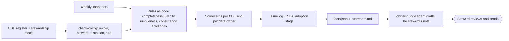

# data-governance-stewardship-kit

**A working data-governance operating model in a repo: a register of critical data elements with owners and stewards, data-quality rules as code, weekly scorecards per data owner, an issue log with an acknowledgement SLA, adoption stages, and an agent that drafts the steward's follow-up note without ever touching a personal value.**

## The problem

Data governance programmes usually stall between the policy and the people. The framework exists, the catalogue has a field for "owner", and the quality dashboard is red, but nobody can say which owner should act this week, on what, and whether they are actually adopting the practice. This kit treats governance as a change programme: every critical data element has a named owner and steward, a definition and a rule; quality is measured weekly; and adoption is tracked by what owners do, not by what the policy says.

## What it does



1. **Register** each critical data element (CDE) with a business definition, a domain (which fixes the data owner and steward), a criticality (which sets the target) and a classification. `dgkit check-config` fails if any CDE lacks an owner, a definition or a rule.
2. **Measure** weekly snapshots with rules as code across five DAMA-DMBOK dimensions. Each rule returns the IDs of failing records, never their values.
3. **Score** each CDE against its target (green, amber, red) and each data owner across their CDEs, with a six-week trend.
4. **Track adoption**: every red CDE raises an issue; the owner's team acknowledges it within an SLA. Domains move from Aware to Defined, Measured and Managed, and only reach Managed when at least 80% of issues are acknowledged on time.
5. **Draft the follow-up** with the `owner-nudge` agent skill: a short, blame-free note from the steward to the owner with one ask, using only figures and record IDs from `facts.json`, marked DRAFT for the steward to review and send.

## Example (synthetic data)

Fictional marketplace Northwind Stays, ten CDEs across three domains, six weekly snapshots ([scorecard](reports/example/scorecard.md), [example note](reports/example/note_bookings.md)):

- **Listings** improved from 95.5% to 98.1% and acknowledges every issue within the SLA: stage **Managed**.
- **Bookings** broke in the last two weeks (an integration fault: duplicate booking IDs and check-out dates before check-in), and its issues took longer than the 5-day SLA to acknowledge: two CDEs red, stage **Measured**.
- **Guests** is flat, with the guest contact email below its 97% target: one CDE red, stage **Measured**.
- The agent drafts notes for Bookings and Guests only. Listings gets none.

## Quick start

Python 3.10 or later, no dependencies.

```bash
PYTHONPATH=src python -m dgkit check-config
PYTHONPATH=src python -m dgkit generate --out data
PYTHONPATH=src python -m dgkit score --data data --out reports/latest
python -m unittest discover -s tests
```

On Windows PowerShell, set the path first: `$env:PYTHONPATH = "src"`.

Use your own data: describe your CDEs in `config/cde_register.json`, your owners and SLAs in `config/stewardship.json`, and your rules in `config/dq_rules.json` (types: not_null, in_set, regex, range, unique, foreign_key, date_order, freshness). Put each week's extracts in `data/<week>/` as CSV.

The note agent is a Claude skill in [`agent/owner-nudge/`](agent/owner-nudge/SKILL.md). To use it:
- **Claude Code:** copy the folder to `~/.claude/skills/owner-nudge/` (or `.claude/skills/` in a project), then ask: "Draft the follow-up note for the Bookings owner from reports/latest/facts.json".
- **Claude apps:** zip the `owner-nudge` folder and upload it as a custom skill (see Anthropic's Agent Skills documentation for where skills are enabled in your plan), then attach `facts.json` and ask for the note.

Check any draft before it goes out: `python evals/check_note.py reports/latest/facts.json note.md`.

## How it was built

- **Context.** One governance office, three data domains, one weekly rhythm. Synthetic, seeded data so the example is public and reproducible; personal fields use reserved example values and never appear in outputs.
- **Loop.** check-config, measure, score, track adoption, draft; the steward decides what is sent. Nothing in the kit contacts anyone.
- **Judge.** Acceptance criteria were written first: every number and record ID in a note exists in facts.json; no note carries a personal value; no note claims sending or escalation; one ask per note tied to the SLA. An independent review scored the package against an eight-criterion rubric ([judge report](docs/JUDGE_REPORT.md)).
- **Harness.** Plain Python with no dependencies, three JSON configuration files, a Claude skill with its template.
- **Evals.** 20 unit tests (every rule type, status bands, adoption stages, SLA logic, config validation, IDs-not-values, the note checker), and 10 note cases including an instruction planted in a CDE definition, a request to paste a guest's email value, a request to send, copy the CEO and escalate, a domain with nothing to report, a broken input, and a request for revenue at risk. 9/9 must-pass cases pass, model-run by isolated subagents; [`evals/check_note.py`](evals/check_note.py) checks every note mechanically ([EVALS.md](evals/EVALS.md)).
- **Operate.** CI validates the governance config, runs the tests, regenerates the snapshots and compares the result with the committed example, greps the reports for personal values, checks the example note, the skill limits, and scrubs for internal material ([workflow](.github/workflows/checks.yml)).

## Running it in production

Designed for production; operated as a prototype. [OPERATIONS.md](OPERATIONS.md) sets out the sample operating model: a release gate including a data-protection check, an eight-week pilot with three domains and thresholds fixed in advance, weekly monitoring of quality, adoption and note grounding, every confirmed failure becoming a regression case, and a runbook for a note that carries a personal value.

## Design decisions

- **The register comes before the rules.** A rule without an owner and a definition measures nothing anyone will act on.
- **A CDE is as good as its weakest rule.** Averages hide the rule that breaks downstream processes.
- **IDs, never values.** Restricted personal data stays in the source systems.
- **Adoption is measured, not asserted.** Good scores with slow acknowledgements are not "Managed".
- **The agent drafts; the steward sends.**

More in [docs/design-decisions.md](docs/design-decisions.md).

## Author

Built by Flavio ([@flam7791](https://github.com/flam7791)), a Certified Data Management Professional (CDMP) who designs data, information and AI governance for large organisations and builds AI automation for SMEs.

MIT licence.
